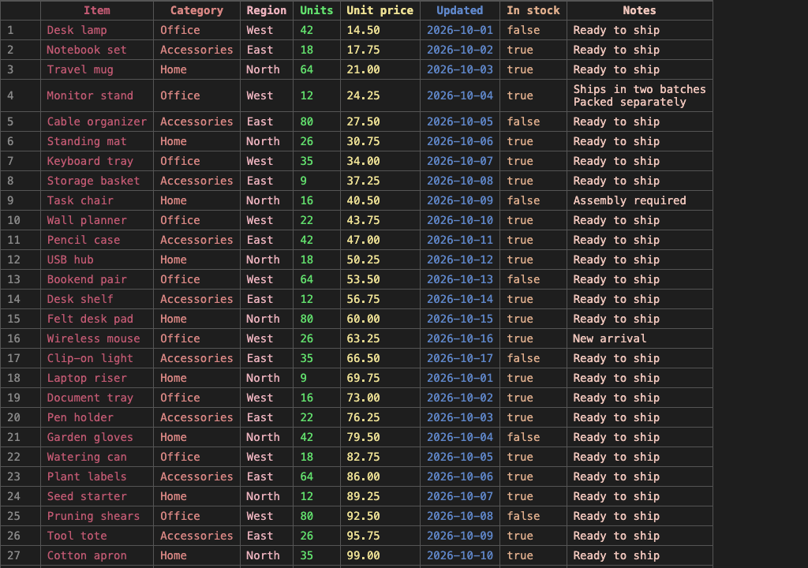
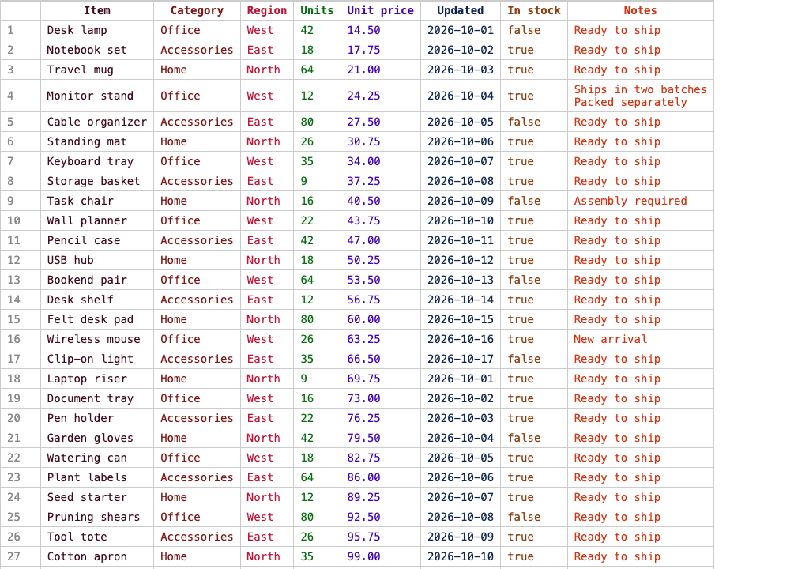
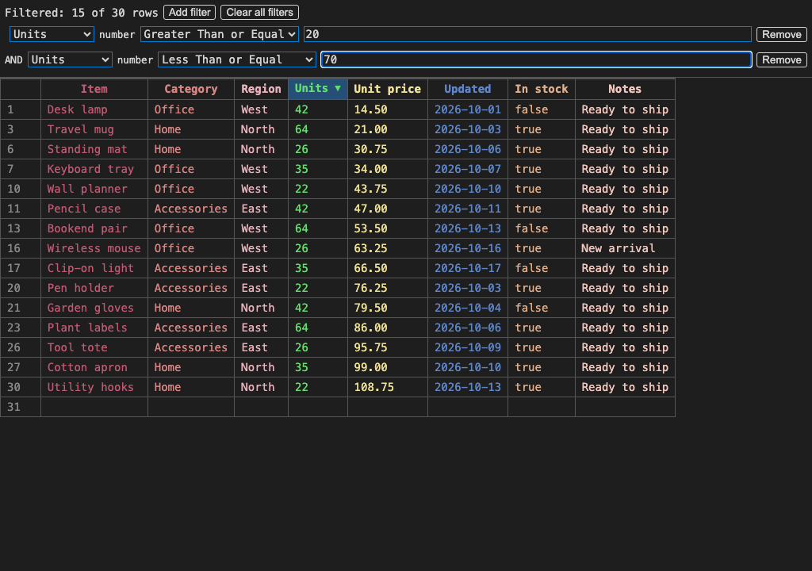

# CSV

View and edit `.csv`, `.tsv`, `.tab`, and `.psv` files as tables in VS Code. CSV supports multiline cells, selection and clipboard operations, column filters, frozen panes, and a text-view switch for working with the underlying file.

Actual CSV table webview with example data, captured in Chromium.

## Open and edit a file

Install **CSV** by **ReprEng** from the Extensions view, then open a supported file. CSV opens it as a table unless your editor associations select another editor. The default separators are comma for `.csv`, tab for `.tsv` and `.tab`, and pipe for `.psv`.

1. Click a cell to select it. Type to start a quick edit, or press Enter or double-click for detail editing.
2. Press Enter or Tab, click outside the cell, or move focus away to commit its text to the VS Code document. In quick edit, arrow keys also commit and move to the adjacent cell. In detail edit, arrows move the text caret; Shift+Enter inserts a line break.
3. Press Ctrl/Cmd+S to commit the active cell and save the document. Committing a cell alone does **not** write the file to disk; VS Code's autosave can save committed document changes if enabled.

Escape cancels the active cell draft. If VS Code rejects an edit, its draft stays available: retry it or press Escape to discard it before structural operations, switching views, or disabling the table. Changes remain unsaved until a save succeeds.

An empty file can be edited immediately. The extra bottom row is an append affordance; entering a value creates source data, while leaving it empty does not. Disable `csv.showTrailingEmptyRow` to hide it.

CSV declares support for VS Code **1.70 or later**. Saved-file table/text replacement requires **1.100** for clean documents and **1.120** for documents with unsaved changes. Older hosts show update guidance for that action.

## Select, copy, paste, and arrange data

Selection is visible as soon as you press the mouse button. Drag or Shift+click to select a range. Click a header to select its column; a second separate click on the same header selects only the header cell. Double-click edits the header. Click the serial index to select a row, or the top-left corner to select the table. Shift+click extends whole-row or whole-column selections.

Use Ctrl/Cmd+C or X, or the selection's right-click **Copy** or **Cut** action. Clipboard data uses the active separator and quotes each value only when needed, preserving separators, line breaks, literal quotes, surrounding whitespace, and real empty cells. The serial index and extra append row are excluded. Selecting only the append row leaves the clipboard unchanged. Clipboard shortcuts inside cell edits, Find, Replace, and filter inputs keep their normal text-editing behavior.

Paste with Ctrl/Cmd+V in selection mode or the right-click **Paste** action. A single value fills a selected rectangle; a copied matrix starts at the selection. With filters active, copying, cutting, filling, and matrix paste use matching source rows. Additional pasted rows append at the physical end of the file. Nonmatching rows stay intact, and saving includes the full file.

Right-click cells to insert or delete rows and columns. Multi-selection actions use the selected count. Drag selected headers or row indices to reorder a column/row or selected group. Right-click a header to sort ascending or descending; with filters active, sorting rearranges matching rows within their source positions and leaves hidden rows in place. These operations change the document and require saving like other edits. Unchanged field quoting and existing line endings are preserved; new values follow a consistent existing column quote style where available.

Context menus open toward the available space, flip above or left when needed, and scroll in small panes. Resizing the editor or changing CSV zoom dismisses an open menu.

## Headers, metadata rows, widths, and frozen panes

- **Header:** Right-click a cell in the first visible source row and choose **Use first row as header** or **Treat first row as data**. Hidden leading metadata is skipped; filtering does not promote an arbitrary matching row to the header. The Command Palette also provides **CSV: Toggle First Row as Header**.
- **Serial index:** Right-click an index cell or its top-left corner and choose **Hide serial index column**. Restore it with **CSV: Toggle Serial Index Column**. The numbers identify source rows and can have gaps while filtering.
- **Metadata:** **CSV: Hide First N Rows** hides leading records without deleting them. Blank input inherits `csv.defaultIgnoreRows`; an explicit `0` shows them even if the configured default is nonzero.
- **Widths:** Automatic column widths account for the longest line in multiline cells. Drag close to a column boundary to resize, including with headers off. Double-click the boundary to restore automatic sizing. Manual widths are remembered per file; narrow columns retain a selectable center. Drag the bottom edge of a serial-index cell to adjust its row height.
- **Word wrap:** Use **Word wrap** above the grid to switch between wrapped values and single-line cutoff with an ellipsis. Automatic widths remain capped at 100 characters; manual widths and row heights stay intact. Cutoff lets long rows collapse or be resized shorter. The selected cell/range stays selected and its active cell stays in view. Editing always shows the full value, and copying, searching and saving use the complete text. The display choice is remembered with the table's webview state.
- **Frozen panes:** Right-click to freeze through a visible row or data column, or use **CSV: Freeze Leading Rows/Columns**. Enter `0` to unfreeze an axis. Counts are remembered per file. By default, the header stays frozen; with headers off, no rows freeze until requested. Hidden metadata and the append row do not count. Frozen rows follow measured multiline/zoomed heights and paint their divider seams; the serial index stays alongside frozen data columns.

Header, serial-index, separator, hidden-row, manual-width, and frozen-pane preferences do not change CSV contents and are stored per file URI in VS Code workspace state. Scroll, selection, row heights, and zoom use webview state. Column colors follow the selected datatype palette (`default`, `cool`, or `warm`) or the theme foreground mode. Light, dark, and high-contrast themes retain that choice. CSV's zoom changes the table's text size independently of global editor zoom.

## Live column filters

Right-click a data column and choose **Filter this column** to add a condition above the table. Choose a column and operator, then type a value; results update as you type without replacing the focused input. **Add filter** and repeated context actions add conditions, including multiple conditions on the same column. All conditions combine with **AND**. Remove one condition or use **Clear all filters** to remove them all.

Every column offers Contains, Does Not Contain, Regular Expression, Equals, Does Not Equal, Is Empty, and Is Not Empty. Number and date columns also offer `>`, `>=`, `<`, and `<=`. Types are inferred from the original body rows, excluding the effective header and hidden metadata, before any filters apply. A text column whose nonblank cells all parse as supported dates also offers date comparisons without changing its column colors.

- Text comparisons ignore case. Numbers accept finite decimal/scientific values and consistent thousands grouping, and compare without rounding away significant digits.
- Boolean equality accepts `true/false`, `t/f`, `yes/no`, `y/n`, `on/off`, and `1/0`.
- Dates accept ISO/year-first forms, numeric dates with four-digit years, and English month names, with optional times and timezone offsets. Unzoned values use UTC. Ambiguous numeric dates use month/day/year: `03/04/2026` means March 4; `13/04/2026` is unambiguously April 13. Use ISO dates or month names to avoid ambiguity. Supported timestamps compare exactly, including sub-millisecond fractions.
- Regular Expression uses [RE2 syntax](https://github.com/google/re2/wiki/Syntax). Plain patterns ignore case; `/pattern/flags` supports `i`, `m`, and `s`. An explicit empty flag list (`/pattern/`) is case-sensitive. Lookaround and backreferences are unsupported.

A zero-length value leaves a draft condition inactive, except Is Empty/Is Not Empty, which need no value. Literal spaces are valid text searches. Invalid or incomplete values show an inline error and retain the last valid results. Blank or invalid cell values do not match typed comparisons, including Does Not Equal; use Is Empty for empty cells. Incomplete IME text is not applied automatically after a view refresh.

Filtering scans the full editable document, retains source row identities, and does not delete source rows. Valid conditions are remembered per file and can contain sensitive data; see [Privacy and data handling](PRIVACY.md). Blank or invalid drafts are not persisted.

## Find, native search, and text view

Ctrl/Cmd+F opens table Find; Ctrl/Cmd+H opens Find and Replace. Match case, whole-word, regular expression, selection-only search, and single/all replacement are available. Table Find includes later chunks. With filters active, Find and Replace All use matching displayed rows and the header; hidden metadata and nonmatching rows are excluded.

Ctrl/Cmd+Shift+F and Ctrl/Cmd+Shift+H remain VS Code's native Find/Replace in Files shortcuts. Alt-modified variants also stay outside the table overlay.

Use the toolbar switch or **CSV: Switch Between Table and Text** to edit the same document as source text. For saved files, the target opens before the source view is replaced, so one representation remains in that editor group. Live cell edits commit first, unsaved changes remain unsaved, and unrelated tabs/groups are retained. If the file already has a table in another group, switch from that group.

For a saved local `file:` URI without an authority, query, or fragment, choosing Text also installs a reversible file-path editor association. Native Find in Files can then open that file in text at the selected result while CSV remains enabled. The choice survives restart and Off/On; switching successfully back to Table restores only CSV's owned association. Other files keep their normal editor choice. Intervening user choices are preserved. Patterns use VS Code's case-insensitive matching, so case-distinct paths are not independently isolated. CSV reports longer/conflicting associations or settings restrictions that prevent native routing.

**Search boundary:** this does not add native search navigation inside a table. A cold search into a file still associated with the table may open the table without revealing the match. Remote/virtual URIs that cannot be isolated by these patterns can switch views, but need CSV turned off for native text search routing. **CSV: Toggle Extension On/Off** temporarily routes CSV's four selectors and explicit CSV associations to native text while off, then restores owned preferences when enabled again. It honors an explicit workspace `csv.enabled` value, otherwise it toggles the global value. Re-enabling upgrades the invoking saved text tab when its restored editor choice is CSV; other already-open text tabs keep their current view until reopened or explicitly switched.

## Untitled CSV and TSV

Choose CSV or TSV language mode in a new untitled text document to open a table before saving. The native text tab remains its unsaved owner. Switching the table to text commits the live cell and closes only the temporary table; switching back recreates a table against that same document. Language changes preserve pending edits before refreshing the table.

Use the table toolbar's **Save Untitled Document As…** action or Ctrl/Cmd+S in selection or editing mode. CSV commits the active cell, reveals the native owner, and invokes VS Code's normal Save As flow. The temporary table closes when the untitled document becomes a saved file. Cancelling Save As retains the unsaved owner and table. Native **File > Save** cannot directly target a standalone table panel; switch to text before using that native action.

Separator, header, serial-index, metadata, and filter controls work before saving. File encoding can be changed after saving. Untitled documents are not switched with the saved-file native replacement operation because associated-path untitled buffers require their existing owner.

## Large File Preview

The normal editable view uses a full VS Code text document; chunked rendering does not bound source-memory use. To inspect a very large saved file without first allocating that document, right-click it in Explorer and choose **CSV: Open Large File Preview (Read-only)**, or run that command and pick a file. Opening the preview after an editable tab does not undo memory already allocated by VS Code.

The preview reads bounded saved-file blocks and displays one page at a time. **Next**, **Previous**, and **Back to Start** navigate complete records, including quoted multiline fields. The first record is data. There is no editing, global search, sorting, or filtering, and unsaved edits in another view are not included.

It supports valid **UTF-8**, an optional UTF-8 BOM, a single ASCII separator, and host-local `file:` URIs. It reads directly in the extension host; arbitrary remote filesystem-provider URIs and other encodings are unsupported. Use a per-file separator override or `extension`/`default` separator mode; automatic detection without an override produces an actionable error.

`csv.largeFilePreviewRows` sets a maximum of 1–10,000 records per page (default 1,000). Independent limits are 512 KiB of source records and 20,000 cells per page, 256 KiB per record, and 1,000 columns. Pages may be smaller. Malformed/oversized records produce errors instead of truncated data. Only the current page and up to 32 page positions are retained; **Previous** reaches that retained history. If the saved file changes, use **Back to Start**.

## Compare two files as tables

Select two files in Explorer and choose **CSV: Compare Files as Table**, or run the command from an active CSV/text document and select the modified file. With no active source, choose original and modified files. Both panes are read-only and use VS Code's decoded document text, including unsaved edits; editing a source refreshes the comparison.

The comparison aligns records around insertions/deletions, highlights changed cells, and shows placeholders for missing records or fields. Both scroll axes stay synchronized and paired rows share their height. Use **Previous/Next Change** and **Previous/Next Page**. The first record is data; comparison uses parsed values and field presence, not quoting or line-ending formatting.

The existing `csv.maxFileSizeMB` limit applies. Hard per-input limits are 10 MiB of saved bytes before a new document opens, 5 MiB of decoded text, 10,000 records, 100,000 cells, and 1,000 columns; values are limited to 64 Ki characters and records to 256 Ki characters. A provider without size information must already have the document open. Pages are capped at 200 aligned records, 20,000 body cells, and 512 Ki characters. Oversized/malformed inputs show errors without truncation. Bounded alignment falls back to positional pairing with a visible notice when necessary.

This command is a separate table comparison. It does not provide native Git/PR custom-editor diff navigation; stable APIs do not reliably expose both input URIs for that flow.

## File encoding

Editable views use Unicode text decoded by VS Code. Run **CSV: Change File Encoding**, choose **Reopen with Encoding**, and select the original file's encoding to correct incorrectly displayed characters. Check the text before saving. Cancelling the unsaved-changes prompt stops the command without discarding your edits. **Save with Encoding** changes how the current text is written; it cannot repair characters already decoded incorrectly. Use the original file or a backup if a corrupted version was saved.

A nonmodal warning appears once per opened document containing the replacement character `�`, offering the encoding action. This is a possible decoding mismatch, not automatic encoding detection: `�` can be legitimate text, and other incorrect decodings may not produce it. CSV does not guess, transcode, or repair bytes automatically. The read-only preview's UTF-8 restriction is separate from this editable-view workflow.

## Commands

Run these from the Command Palette. Commands that change a view preference target the active CSV table unless noted.

| Command | Purpose |
| --- | --- |
| **CSV: Switch Between Table and Text** (`csv.toggleEditor`) | Switch the active supported table/text view. |
| **CSV: Save Untitled Document As…** (`csv.saveUntitled`) | Commit and save the active untitled table through the native owner. |
| **CSV: Toggle Extension On/Off** (`csv.toggleExtension`) | Enable/disable CSV and synchronize native editor routing. |
| **CSV: Toggle First Row as Header** (`csv.toggleHeader`) | Change the file's header preference. |
| **CSV: Toggle Serial Index Column** (`csv.toggleSerialIndex`) | Show/hide the file's serial index. |
| **CSV: Change CSV Separator** (`csv.changeSeparator`) | Override the separator; blank input inherits configured rules. Enter `\t` for tab. |
| **CSV: Reset CSV Separator (Inherit)** (`csv.resetSeparator`) | Clear the file's separator override. |
| **CSV: Hide First N Rows** (`csv.changeIgnoreRows`) | Override the metadata-row count; blank input inherits the default. |
| **CSV: Freeze Leading Rows** (`csv.changeFrozenRows`) | Set the number of leading visible rows to freeze; `0` unfreezes. |
| **CSV: Freeze Leading Columns** (`csv.changeFrozenColumns`) | Set leading data columns to freeze; `0` unfreezes. |
| **CSV: Change File Encoding** (`csv.changeEncoding`) | Open VS Code's encoding picker for a saved file. |
| **CSV: Change Font Family** (`csv.changeFontFamily`) | Pick an extension-host font or inherit `editor.fontFamily`. |
| **CSV: Toggle Clickable Links** (`csv.toggleClickableLinks`) | Toggle link interaction globally. |
| **CSV: Open Large File Preview (Read-only)** (`csv.openLargeFilePreview`) | Open a saved host-local file in the bounded preview. |
| **CSV: Compare Files as Table** (`csv.compareFilesAsTable`) | Choose two source files for read-only table comparison. |

## Settings

All settings are under `csv.*` in VS Code Settings or `settings.json`. Font and mouse-wheel zoom settings are application-scoped. Per-file commands override the relevant inherited view defaults.

| Setting | Default | Behavior |
| --- | --- | --- |
| `csv.enabled` | `true` | Enable the custom editor; the toggle command also manages reversible native routing. |
| `csv.fontFamily` | `""` | Inherit `editor.fontFamily`, or use the specified font family. |
| `csv.fontSize` | `0` | Inherit `editor.fontSize`, or use a positive pixel size. |
| `csv.mouseWheelZoom` | `true` | Allow Ctrl/Cmd+mouse wheel table zoom. |
| `csv.mouseWheelZoomInvert` | `false` | Reverse the table zoom direction. |
| `csv.cellPadding` | `4` | Vertical cell padding in pixels. |
| `csv.columnColorMode` | `"type"` | `type` uses datatype colors; `theme` uses theme foreground. |
| `csv.columnColorPalette` | `"default"` | `default`, `cool`, or `warm` when color mode is `type`. |
| `csv.diffUseThemeForeground` | `true` | Use theme foreground for CSV views recognized as diff contexts. |
| `csv.clickableLinks` | `true` | Enable Ctrl/Cmd+click on recognized links. |
| `csv.showTrailingEmptyRow` | `true` | Show the extra append row. |
| `csv.separatorMode` | `"extension"` | `extension` uses extension mapping, `auto` detects from content first, `default` uses the configured default. Per-file overrides take precedence. |
| `csv.defaultSeparator` | `","` | Fallback separator. Use `"\t"` in JSON for a tab character, or `"\\t"` for the supported literal escape. |
| `csv.separatorByExtension` | CSV comma; TSV/TAB tab; PSV pipe | Extension mapping; keys accept `.ext` or `ext`. |
| `csv.maxFileSizeMB` | `10` | Editable-view size prompt. `0` disables it; **Ignore Forever** sets it to `0`. This is not a memory cap. |
| `csv.defaultIgnoreRows` | `0` | Hidden leading metadata records when no per-file override exists. |
| `csv.largeFilePreviewRows` | `1000` | Preview records per page, from `1` to `10000`, subject to byte/cell caps. |

Header mode, serial-index visibility, separator overrides, hidden rows, widths, frozen panes, and valid filter conditions are remembered per file. They change the view, except operations such as sorting, editing, and structural changes that explicitly modify document data.

## Keyboard and mouse reference

Ctrl/Cmd means Ctrl on Windows/Linux and Command on macOS. Table shortcuts apply outside text inputs unless noted.

| Action | Shortcut or gesture |
| --- | --- |
| Select a cell/range | Click / drag / Shift+click |
| Select a row or column | Click its serial index or header; Shift+click extends the range |
| Select only a header cell | A second separate click on the same header |
| Select the table | Ctrl/Cmd+A, or click the top-left corner |
| Move selection | Arrow keys; holding a key keeps the target visible |
| Extend selection | Shift+Arrow |
| Jump to a table edge | Ctrl/Cmd+Arrow |
| Extend to an edge | Ctrl/Cmd+Shift+Arrow, retaining the starting anchor and row/column shape |
| Next/previous cell | Tab / Shift+Tab; wraps across data rows |
| Quick edit | Type on a selected cell; arrows commit and move |
| Detail edit | Enter or double-click; arrows move the caret |
| Commit and move while editing | Enter moves down; Tab/Shift+Tab moves across |
| Insert a cell line break | Shift+Enter |
| Cancel a draft | Escape; a failed edit restores its current source value |
| Save | Ctrl/Cmd+S commits the active cell, then saves (Save As for untitled) |
| Copy / cut / paste | Ctrl/Cmd+C / X / V, or right-click actions |
| Clear selected values | Delete / Backspace |
| Table Find / Replace | Ctrl/Cmd+F / H |
| Native Find / Replace in Files | Ctrl/Cmd+Shift+F / H |
| Next/previous Find match | F3 / Shift+F3; Enter/Shift+Enter in Find; Ctrl/Cmd+G/Shift+G while Find is open |
| Resize / reset a column | Drag / double-click near its boundary |
| Resize a row | Drag the bottom edge of its serial-index cell |
| Reorder rows/columns | Drag selected serial indices/headers |
| Zoom in / out / reset | Ctrl/Cmd+plus / minus / 0; Ctrl/Cmd+mouse wheel if enabled |
| Open a recognized link | Ctrl/Cmd+click |

## Privacy and development

See [Privacy and data handling](PRIVACY.md) for local/remote processing, clipboard and link actions, diagnostics, and saved preferences. CSV has no upload service or extension-specific analytics client. Remote workspaces can process files in the remote extension host.

For development, use Node 20 and run `npm ci`, `npm test`, and `npm run lint`. `npm run package` creates the VSIX. See [the changelog](CHANGELOG.md) for release history and [REVIEW.md](REVIEW.md) for repository priorities.
